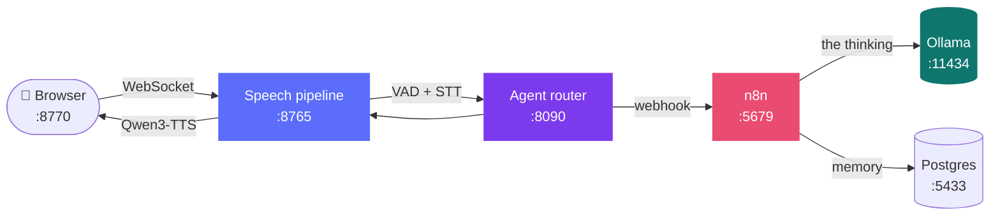

<div align="center">

# 🎙️ CLARA

### A local voice agent with an n8n backend

**Talk to your computer. It talks back. Nothing ever leaves the machine.**

[](LICENSE)
[](#-requirements)
[](https://n8n.io)
[](#-privacy)

</div>

---

## ✨ What it is

Speech in, speech out, entirely on your own hardware. No API keys, no cloud, no per-minute billing.

Click the page and start talking — there's no push-to-talk, and you can interrupt it mid-sentence.

The part that makes it more than a chatbot: **every agent is an n8n workflow.** CLARA handles the ears and the voice; n8n does the thinking. So an agent can read your calendar, query a database, or reach any of n8n's 400+ integrations — and answer you out loud.

```
🎤 ─▶ Silero VAD ─▶ Parakeet TDT ─▶ n8n agent ─▶ Qwen3-TTS ─▶ 🔊
      (did they      (speech         (Ollama)     (the voice)
       stop?)         → text)
```

> 💡 **The model lives in your workflow, not here.** CLARA owns the ears and the voice. The thinking happens in Ollama, driven by n8n — so every agent can run a different model, chosen in the Ollama Chat Model node.

Built on the [huggingface/speech-to-speech](https://github.com/huggingface/speech-to-speech) pipeline. Everything installs **inside this folder** — no admin rights, nothing added to PATH or the registry, no system Python touched. Delete the folder and your machine is exactly as it was.

---

## 📋 Requirements

| | Minimum | Comfortable |
|:--|:--|:--|
| 🪟 **OS** | Windows 10 21H2 / 11, 64-bit | same |
| 💾 **Disk** | 34 GB free | 40 GB |
| 🧠 **RAM** | 16 GB | 32 GB |
| 🎮 **GPU** | none — CPU works, slowly | NVIDIA, 8 GB+ VRAM |
| 🐳 **Docker** | required — runs n8n + Postgres | Docker Desktop |
| 🦙 **Ollama** | required — the Windows desktop app | with `OLLAMA_HOST=0.0.0.0` |
| 🎧 **Audio** | any mic + speakers | a headset |

Docker and Ollama are what the agents actually run on, so both are needed. Everything else installs itself.

> 📁 **Install it anywhere.** Spaces, brackets, apostrophes and non-ASCII characters in the folder name are all fine — `D:\2. CLARA`, `C:\Users\Me\My Projects\CLARA`, `D:\پروژه\CLARA`. `CLARA.cmd` → `3` proves it on your machine, or run `.\utilities\selftest.ps1` directly.

---

## ⚡ Install

> Double-click **`CLARA.cmd`** → press **`5`** → press **`1`**

Expect **30–60 minutes**. Safe to re-run — finished steps are skipped and downloads resume.

<details>
<summary>🔧 Installing only part of it</summary>

| Menu | Installs |
|:--|:--|
| `5` → `1` | Everything |
| `5` → `2` | Voice system only — no Docker needed |
| `5` → `3` | Agent stack only — n8n + Postgres |
| `5` → `4` | Just the GPU PyTorch step |

Or call the script directly:

```powershell
powershell -ExecutionPolicy Bypass -File .\utilities\install-all.ps1 -Agents
```

| Flag | Effect |
|:--|:--|
| `-Voice` | Voice system only |
| `-Agents` | Agent stack only |
| `-Port 5679` | n8n host port |
| `-PgPort 5433` | Postgres host port |
| `-Quant Q4_0` | GGUF quantisation — `Q4_0`, `Q8_0` or `BF16` |

</details>

---

## 🎛️ The menu

Everything runs from **`CLARA.cmd`**:

```
1 start   2 stop   3 check   4 open n8n   5 setup   6 logs   7 version   8 update n8n   q quit
```

| | | |
|:--:|:--|:--|
| 1️⃣ | **start** | Interface, router, speech pipeline. Opens your browser. First start takes 60–90 s while models load — the bar says READY when it's done. |
| 2️⃣ | **stop** | `1` everything · `2` voice only · `3` containers only |
| 3️⃣ | **check** | Health check across files, GPU, Python, models, audio, ports and path handling. **Run this first when anything misbehaves.** |
| 4️⃣ | **open n8n** | Opens the n8n editor |
| 5️⃣ | **setup** | Install or reinstall any part. Safe to re-run. |
| 6️⃣ | **logs** | Recent log files |
| 7️⃣ | **version** | `1` show · `2` update the speech pipeline · `3` undo |
| 8️⃣ | **update n8n** | Newest stable n8n. Backs up workflows and credentials to `n8n\backups\` first. |

---

## 🔄 Updating the speech pipeline

CLARA pins a **tagged release** of [speech-to-speech](https://github.com/huggingface/speech-to-speech), recorded in [`configs/upstream.json`](configs/upstream.json). Everyone who installs gets the same code you tested.

> 🎯 **Currently pinned: `v0.2.12`**

`CLARA.cmd` → **`7`** → **`2`** to move to a newer release. It shows what changed, flags commits that look like breaking changes, checks out the tag, reinstalls dependencies, verifies CUDA survived, and runs the health check. If it goes wrong, **`7`** → **`3`** puts it back.

```powershell
.\utilities\update-upstream.ps1 -List          # what's available
.\utilities\update-upstream.ps1 -Ref v0.2.13   # move to a specific one
.\utilities\update-upstream.ps1 -Rollback      # undo
```

<details>
<summary>❓ Why pin instead of tracking the latest?</summary>

Upstream takes roughly **55 commits a week** on `main` and cuts a release about monthly. `main` is a research branch with no stability contract and no Windows CI.

CLARA exists *because* upstream breaks on Windows — the collapsed section further down lists five separate workarounds, and a CLI change has already broken it once before. Tracking `main` means every install is a different, untested pipeline, and a bug report from someone else can't be reproduced.

Tagged releases are something a human decided to ship. Update on your schedule, verify it works, then commit the new pin so everyone moves together.

⚠️ One thing to watch: reinstalling dependencies can silently pull the **CPU-only** torch wheel over your CUDA build. The update script checks for this and tells you to run `.\utilities\install.ps1 -CudaOnly` if it happens.

</details>

---

## 🤖 First run — build an agent

> ⚠️ **The voice page is empty until you give it an agent, and an agent is an n8n workflow. So n8n comes first.**

### 1️⃣ Open n8n

`CLARA.cmd` → **`4`**, or go to **http://127.0.0.1:5679**

### 2️⃣ Build the workflow — three nodes

<table>
<tr><td width="60" align="center">

### 🪝

</td><td>

**Webhook**

| Setting | Value |
|:--|:--|
| Method | `POST` |
| Path | anything, e.g. `my-agent` |
| Respond | `Using 'Respond to Webhook' node` |

</td></tr>
<tr><td align="center">

### 🧠

</td><td>

**AI Agent**

The router always sends exactly two messages at fixed indexes:

| Setting | Value |
|:--|:--|
| Prompt (User Message) | `{{ $json.body.messages[1].content }}` |
| Options → System Message | `{{ $json.body.messages[0].content }}` |

Then attach:

- 🦙 **Chat Model → Ollama Chat Model** — Base URL `http://host.docker.internal:11434`. **This is where you pick the model.**
- 🗄️ **Memory → Postgres Chat Memory** — host `clara-postgres`, port `5432`, database `agents`, user `clara`, password `clara`, Session Key `{{ $json.body.sessionId }}`, Session ID *Define below*

</td></tr>
<tr><td align="center">

### 📤

</td><td>

**Respond to Webhook**

| Setting | Value |
|:--|:--|
| Respond With | `JSON` |
| Body | `{ "output": "={{ $json.output }}" }` |

</td></tr>
</table>

### 3️⃣ Activate and copy the URL

Save, switch the workflow to **Active**, and copy the **Production** URL.

> 🚨 The **Test** URL only works while the editor is listening. Using it is the single most common mistake.

### 4️⃣ Connect it to the voice panel

At **http://127.0.0.1:8770**, click **Connect to n8n** (or `+` on the left rail). Name the agent, paste the production URL, pick a voice and colours, press **Test** — the reply from your workflow appears, which is the exact path a spoken turn takes. Press **Create**, then click anywhere and talk. 🎉

> 📝 **n8n owns the conversation history.** One agent, one `sessionId`, one row set in Postgres. Don't add history to the prompt yourself or the model sees the conversation twice.

<details>
<summary>🔴 <b>Ollama connection refused?</b> — read this, almost everyone hits it</summary>

Ollama runs as the **Windows desktop app**, not in Docker. n8n runs *in* Docker. So `localhost` inside the node means the n8n container, not your PC — which is why the Base URL is `http://host.docker.internal:11434`.

That alone still isn't enough: Ollama only listens on `127.0.0.1` by default, so containers can't reach it. In Windows environment variables add

```
OLLAMA_HOST = 0.0.0.0
```

…then restart Ollama. Without it the Chat Model node gets a connection refused every time.

Pull models normally, on the host:

```powershell
ollama pull llama3.2
ollama list
```

</details>

---

## 🗣️ Talking to it

Click anywhere on the page and speak. Silero VAD plus Smart Turn work out when you've finished; barge in any time and it stops and listens.

| Key | Does |
|:--:|:--|
| `Space` | 🔇 Mute |
| `Esc` | 🚪 End the conversation |

Hover the coloured bar at the **left edge** for the conversation list:

| | |
|:--:|:--|
| ➕ | New conversation |
| 🔵 | Click a dot to switch · right-click to edit |
| ✏️ | Edit the current one |

Each conversation has its own name, personality, voice, colours and memory. They never mix.

---

## 🏗️ How it fits together



Starting CLARA launches exactly three things — the interface, the router, and the speech pipeline. Docker and Ollama run independently.

| Port | Process | | Runs in |
|:--|:--|:--|:--|
| `8770` | 🖥️ Web interface | Mics need a secure context; `127.0.0.1` counts, `file://` doesn't | CLARA |
| `8765` | 🎙️ Speech pipeline | VAD, speech-to-text, text-to-speech | CLARA |
| `8090` | 🔀 Agent router | Forwards each turn to the agent's n8n webhook | CLARA |
| `5679` | 🔴 n8n | Deliberately off the usual `5678` | Docker |
| `5433` | 🐘 Postgres | Agent memory. Off the usual `5432` | Docker |
| `11434` | 🦙 Ollama | The models. Standard port | Desktop app |

The Docker ports sit off their defaults on purpose, so an n8n or Postgres you already run keeps working untouched. Only `clara-n8n` and `clara-postgres` are ever created.

> 🔊 **Why a browser rather than a desktop app:** `getUserMedia` gives hardware echo cancellation for free. Without it the agent hears itself through your speakers and answers itself. That one feature decided the whole interface.

Full detail in [`architecture/ARCHITECTURE.txt`](architecture/ARCHITECTURE.txt) and [`architecture/CONNECT-N8N.txt`](architecture/CONNECT-N8N.txt).

---

## ⚙️ Tuning

Everything lives in `configs\serve-gpu.json`. Edit, save, restart.

| Want to | Change |
|:--|:--|
| 🎭 Use a different voice | `qwen3_tts_speaker` (default `Aiden`) |
| 🌍 Speak another language | `language` → `fr`, `de`, `zh`… or `auto` |
| 💬 Keep more history | `chat_size` |
| ✋ Stop it cutting you off | `min_silence_ms` — raise from `250` toward `400` |
| ⚡ Make it reply faster | `min_silence_ms` — lower toward `150` |
| 🎚️ Make it more/less trigger-happy | `thresh` — lower is more sensitive |

To list available voices, set `qwen3_tts_speaker` to something invalid and start — the log prints `Supported speakers: …` and falls back to the default.

### 🧮 Choosing the model

**Models are per-agent, chosen in the workflow** — the Ollama Chat Model node. There's no global model setting, and two agents can happily run different ones.

> ⚠️ **Size is capped by VRAM, not preference.** Qwen3-TTS and Parakeet are already resident and hold about 7 GB. On a 16 GB card that leaves roughly 5 GB for the language model. Go bigger and Windows spills into system memory, which lags the *entire computer* — not just this app. If everything suddenly feels sluggish, check this first.

---

## 🔒 Privacy

Your voice, your text, and your workflows never leave the machine. The only network traffic is the one-time model download during install.

The Postgres credentials (`clara` / `clara`) are a local default on a container bound to `127.0.0.1`. Change them if you ever expose it.

---

## 🩺 Troubleshooting

> Run **`CLARA.cmd`** → **`3`** first. It tests every layer and tells you which one failed.

| Symptom | Fix |
|:--|:--|
| 🔴 Ollama connection refused | Set `OLLAMA_HOST=0.0.0.0`, restart Ollama, use `host.docker.internal` |
| 🪝 Workflow never fires | You pasted the **Test** URL. Use **Production**, and activate the workflow. |
| 🐳 n8n unreachable | Is Docker Desktop running? `docker logs -f clara-n8n` |
| 🤐 Nothing happens when you talk | Mic meter not moving = no browser mic permission. Check the address bar. |
| 🧊 Page blank or frozen | `Ctrl` + `Shift` + `R` |
| ✂️ Cuts you off mid-sentence | Raise `min_silence_ms` toward `400` |
| 🐌 Waits too long to reply | Lower `min_silence_ms` toward `150` |
| 🚧 Ports busy | `CLARA.cmd` → `2` → `1` |
| 🥵 Whole PC lags | Model too big for the VRAM left after the speech models |
| 💥 Everything is broken | `CLARA.cmd` → `5` → `1`. Safe to re-run. |

Logs live in `logs\` — `pipeline.log`, `router.log`, `interface.log`.

<details>
<summary>🪟 Windows-specific gotchas already handled here</summary>

Recorded so nothing surprises you later.

**Qwen3-TTS runs on the `torch` backend, not GGML.** `faster-qwen3-tts` installs without the `[ggml]` extra on Windows, so the default `ggml` backend fails at start-up. The config sets `"qwen3_tts_backend": "torch"`.

**PyPI ships CPU-only PyTorch for Windows.** A plain `uv sync` silently gives you a GPU-less install that runs everything on the CPU. `install.ps1` detects the driver's CUDA version and reinstalls torch/torchaudio from the matching index (cu126 / cu128 / cu130).

**RTX 50-series needs cu128 as a floor.** Blackwell is compute capability sm_120, and the cu126 wheels ship no sm_120 kernels — CUDA ops die with *"no kernel image is available"* even though the GPU is detected fine. The installer recognises those cards by name and never selects cu126 for them.

**`onnxruntime` is missing upstream.** Smart Turn imports it but it isn't declared in `pyproject.toml`, so a stock install crashes. `install.ps1` adds it.

**Caches are redirected into the folder.** `HF_HOME`, `TORCH_HOME` and `NLTK_DATA` all point at `models\`, so nothing accumulates in `C:\Users\<you>\.cache`.

</details>

---

## 💡 Ideas and problems

CLARA is early, and the roadmap is shaped by what people actually ask for.

**💭 Got an idea?** Open an issue with the `enhancement` label. Wake-word activation, streaming replies from n8n, a Linux or macOS port, multi-user sessions, a workflow gallery — all on the table, and the ones people ask for get built first.

**🐞 Something broken?** Open an issue with:

- What you expected vs what happened
- Your Windows version, GPU and VRAM
- The output of `CLARA.cmd` → `3`
- The last 20 lines of the relevant file in `logs\`

**🎨 Built an interesting agent?** Start a discussion and describe it. Workflow *patterns* are the most useful thing to share — and unlike workflow files, a screenshot and a description give nothing private away.

<div align="center">

### 📌 [Open an issue](../../issues/new) · 💬 [Start a discussion](../../discussions) · ⭐ Star it

</div>

---

## 📜 Licences

CLARA is [MIT licensed](LICENSE). The pipeline is Apache-2.0. The models carry their own — Gemma (Gemma Terms of Use), Qwen3-TTS and Parakeet TDT (see their model cards), Silero VAD (MIT), Smart Turn v3 (see its model card). Worth reading before commercial use.

<div align="center">
<sub>Built with 🦙 Ollama · 🔴 n8n · 🤗 speech-to-speech</sub>
</div>
